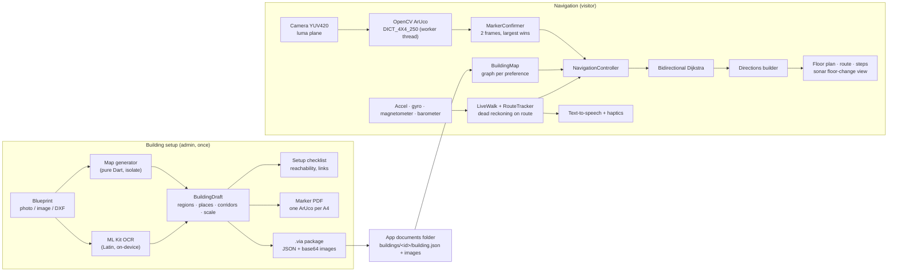

# Via — Project Video Brief

> **Name:** the app is now called **Via** (formerly "Indoor Nav"). "Indoor navigation" below describes what it does.

The source document for the Via launch film and the longer pitch cut for the Dean (both to be made later with the Brag and HyperFrames skills). It comes from an audit of the code on `feature/building-setup` (HEAD `e1607cd`, 34 commits), the earlier code under `Project Code/`, the first commit's ESP32 firmware, and the team's reports in `Existing Details and Reports/`.

**Ground rule for the film:** every claim on screen must match the status labels in this brief. Show **Implemented** features as working. Show **Partial** features with a qualifier ("beta", "experimental", "being field-tested"). Show **Planned** features only as "next" or "coming". Never show them as finished.

Status labels used throughout:

| Label | Meaning |
| --- | --- |
| **Implemented** | Wired from the UI through to the logic, and covered by automated tests. |
| **Partial** | The UI and logic exist, but the result is heuristic, incomplete, or not yet checked on a real phone. |
| **Planned** | Only in reports, comments or ideas. No code. |

---

## 1. Project overview

**Via** is an offline Android app (Flutter, so iOS is possible) that gives turn-by-turn directions inside buildings, where GPS does not work.

- **Where am I?** You point the phone at a printed ArUco marker (a square black-and-white tag) on the wall. On-device OpenCV reads it.
- **How do I get there?** The phone itself works out the shortest route across floors, using stairs and lifts, with a corrected bidirectional Dijkstra.
- **Follow me.** Optional "scan once, then walk" mode uses step counting plus gyro and compass heading to move your dot along the route and speak the turns.
- **Any building.** Whoever manages a building uploads a blueprint photo or CAD file. The app turns it into a clean vector map of rooms and corridors and reads room names from the plan. It then prints the markers to stick up and packs the whole building into one file you can share.

Nothing needs a server, an account, Wi-Fi, beacons or the internet. The only infrastructure is paper stickers.

**Team (from the synopsis/PPT):** Sairam V S, Rohit Kumar Golla, Shreyas M Gautham, Siddharth Yandapalli, Siddhanth Satish. Guide: Prof. Shilpa A Hiremath, School of CSE, RV University. *(Confirm the credit line with the team before release.)*

### How it got here (a story beat for the film)

| Stage | What it was | Where it lives now |
| --- | --- | --- |
| 1. Synopsis | "NFC Based Smart Navigation System": NFC tags, an ESP32 microcontroller, Firebase, an Android NFC app. | `Existing Details and Reports/PROJECT SYNOPSIS - NFC Based Navigation System.pdf` |
| 2. Mid-term PPT | Pivot to vision: "Indoor Navigation System (Using ESP32 and OpenCV)", ArUco markers, Dijkstra on the ESP32, Firebase Realtime DB. | `ESM Project PPT - Group 11 PDF.pdf` |
| 3. Prototype code | ESP32 firmware (Wi-Fi + Firebase stream, Dijkstra in C++); React web app (js-aruco, Express proxy to the ESP32 at `192.168.4.1`); first Flutter app (Firebase RTDB). | Firmware: `git show 693921f:"Project Code/wifi/wifi.ino"` (removed in `9c18328`). Apps: `Project Code/Indoor Nav/` |
| 4. Current app | Everything moved onto the phone and made general-purpose: any building, any number of floors, fully offline. | `Project Code/indoor_nav_mobile/` |

**Narrative hook:** *It used to take a microcontroller, Wi-Fi and a cloud database to find a route. Now it takes a phone and a sticker.*

---

## 2. Problem and solution

### Problem
- GPS does not work indoors. New students, visitors, parents and examiners get lost in multi-floor campus buildings.
- Existing indoor positioning (Wi-Fi fingerprinting, BLE beacons, UWB) needs powered hardware, site surveys, upkeep and usually a cloud backend. That costs money for every building.
- Building maps are static PDFs or wall signs. They don't route you, and they don't know about stairs versus lifts.
- Accessibility: someone in a wheelchair needs a step-free route, not merely the shortest one.

### Solution
| Need | How Via meets it | Status |
| --- | --- | --- |
| Know where you are | Scan a printed ArUco marker. The marker ID maps to a place. | Implemented |
| Route across floors | On-phone bidirectional Dijkstra over a graph of places, corridors, stairs and lifts | Implemented |
| Accessible routing | Route preferences: Fastest / Step-free / Avoid lifts | Implemented |
| Guidance between markers | Step detection plus gyro/compass heading moves you along the route. Turns are spoken, and the phone vibrates for a close turn. | Partial (not field-measured) |
| Cheap to roll out | The admin uploads a blueprint. The app generates the map, reads labels, and prints a marker PDF. | Implemented, with Partial auto-detection |
| Works anywhere | No internet, no account, no server. Buildings are shared as one `.via` file. | Implemented |

---

## 3. Technical architecture

**Layers** (`Project Code/indoor_nav_mobile/lib/`):

| Folder | Responsibility |
| --- | --- |
| `map/` | Parse and validate `building.json` into an immutable `BuildingMap`. Auto-link stairs and lifts across floors. Turn corridor strokes into a network. Build one routing graph per preference. |
| `routing/` | `bidirectional_dijkstra.dart` and `directions.dart` (turns a path into human steps). |
| `navigation/` | `NavigationController` (location, destination, preference, route); `LiveWalk`, `RouteTracker`, `motion.dart` (sensor maths); `device_sensors.dart` (real sensors and TTS). |
| `scanner/` | Camera screen, OpenCV detector, two-frame confirmer, overlay. |
| `mapgen/` | Blueprint → vector map (`floor_map_generator.dart`); OCR reader and label interpretation. |
| `setup/` | Building and floor editors, DXF import, path suggester, checklist, walk-and-check, marker guide and PDF, sharing. |
| `storage/` | On-phone repository and `.via` export/import. |
| `ui/` | Home, navigation screen, floor plan and route painters, sonar floor-change view, theme. |

State management is `provider` / `ChangeNotifier`. Hardware-facing parts (camera detector, motion sensors, speaker, OCR reader) sit behind interfaces, so tests can inject fakes. That is why 192 tests run in CI without a phone.

**There is no backend.** The app's own code makes no network calls. The legacy ESP32/Firebase path survives only in `Project Code/Indoor Nav/` and in git history.

---

## 4. Key features (with status)

### Navigation (visitor side)

| # | Feature | Status | Evidence |
| --- | --- | --- | --- |
| N1 | Scan an ArUco marker to set your location (DICT_4X4_250, backward compatible with the original printed 4X4_50 set) | **Implemented** | `scanner/marker_detector.dart:20`, `scanner/marker_confirmer.dart:12`, `test/scanner/scanner_screen_test.dart` (fake camera). Real OpenCV runs only on a phone: rehearse before filming. |
| N2 | Unknown-marker handling ("Marker N is not on this map") | **Implemented** | `ui/navigation_screen.dart:132-136` |
| N3 | Pick a destination from a searchable list, or by tapping a place on the map | **Implemented** | `ui/place_picker.dart`, `ui/navigation_screen.dart:110,140` |
| N4 | Shortest route across floors via stairs and lifts | **Implemented** | `routing/bidirectional_dijkstra.dart:25`; tested against plain Dijkstra for all 784 sample pairs (`test/routing/bidirectional_dijkstra_test.dart:80`) |
| N5 | Route preferences: Fastest / Step-free / Avoid lifts | **Implemented** | `map/building_map.dart:390` (`graphFor`), chips at `ui/navigation_screen.dart:241` |
| N6 | Step-by-step directions ("Walk to Lift 1", "Take Lift 1 up to the First Floor") | **Implemented** | `routing/directions.dart:17`, `ui/route_steps.dart` |
| N7 | Reroute on any scan (walk off the route, scan anything, get a new route) | **Implemented** | `navigation/navigation_controller.dart:93,128` |
| N8 | **Next** button for stops without a marker ("I'm at …" behaviour) | **Implemented** | `ui/instruction_card.dart:99`, `navigation_controller.dart:101` |
| N9 | **Re-locate**: forget the position, keep the destination, scan again | **Implemented** | `ui/route_steps.dart:32`, `ui/navigation_screen.dart:153` |
| N10 | Set your location manually (location button) | **Implemented** | `ui/navigation_screen.dart:116,205` |
| N11 | Animated **guide dot** running from you to the next stop | **Implemented** | `ui/floor_plan_view.dart:41-46` |
| N12 | **"Dark Knight sonar" 3D floor-change view**: the map becomes a lime wireframe, the camera swings to a side view, and your dot rides the stairs or lift. It plays on a floor change and can be replayed from the steps. | **Implemented** | `ui/floor_change_view.dart:19`, `test/ui/floor_change_test.dart` |
| N13 | Multi-floor plan view with a floor selector (dots mark your floor and your destination's) | **Implemented** | `ui/navigation_screen.dart:347` |
| N14 | **Scan once, then walk**: steps plus fused heading move you along the route, places tick off, turns are spoken and vibrate, and it warns when you go off route | **Partial** | `navigation/live_walk.dart:58`, `navigation/route_tracker.dart:39`. Unit-tested with simulated sensors (`test/navigation/live_walk_test.dart`, 13 tests). Uses a fixed 0.7 m stride and has no field accuracy figures yet. Indoor magnetometer noise is real. |
| N15 | Barometer floor-change detection, with an "I've changed floor" fallback | **Partial** | `navigation/motion.dart:141`, `live_walk.dart:184`. Assumes 0.4 hPa per storey and is untested in the real building; not every phone has a barometer. |

### Building setup (admin side)

| # | Feature | Status | Evidence |
| --- | --- | --- | --- |
| S1 | Create, edit, delete and list buildings on the phone | **Implemented** | `ui/buildings_screen.dart`, `storage/building_repository.dart`, `test/ui/buildings_screen_test.dart` |
| S2 | Add floors from a gallery image or a **camera photo of a printed plan** | **Implemented** | `setup/blueprint_picker.dart:35` |
| S3 | **DXF (CAD) import** with layer picking and real scale from `$INSUNITS` | **Implemented** | `setup/dxf_import.dart:58,118`, `test/setup/dxf_import_test.dart`. No sample DXF is in the repo; you need one to demo it. |
| S4 | **PDF blueprints** | **Not supported** | The picker offers image, camera or DXF only. PDF is used only for *output* (the marker sheet). Don't claim PDF upload. |
| S5 | **Blueprint → vector map**: walls, rooms, corridors (with centrelines), hatched stairwells. Works on dark-on-light and white-on-blue plans. | **Partial** (heuristic auto-detection; works end to end) | `mapgen/floor_map_generator.dart:57`, `test/mapgen/floor_map_generator_test.dart` (14 tests on synthetic plans). Results depend on the drawing, so the admin reviews and fixes them. |
| S6 | Correct the generated map: tap an area to name it or mark it corridor/stairs/lift/not used; trace an area by hand; regenerate with Narrow/Normal/Wider doorway settings; show the blueprint faintly underneath | **Implemented** | `setup/floor_editor_screen.dart:82-130, 500-560` |
| S7 | **Offline OCR**: reads room names and STAIRS/LIFT/CORRIDOR labels from the plan and fills the map without overwriting the user's names | **Partial** (not yet run on a phone) | `mapgen/plan_text_reader.dart:37`, `mapgen/text_labels.dart:66`, `test/mapgen/text_labels_test.dart` (7 tests with fake OCR output). The release build was just fixed to leave out non-Latin models (`android/app/proguard-rules.pro`, `e1607cd`). |
| S8 | Places mode: add rooms, washrooms, entrances, lifts, stairs and landmarks, with automatic marker numbering | **Implemented** | `setup/floor_editor_screen.dart`, `setup/region_form.dart` |
| S9 | Stairs and lifts link across floors by a shared link name, or automatically when in the same spot | **Implemented** | `map/building_map.dart:327-350`, test at `floor_map_generator_test.dart:231` |
| S10 | Paths: **swipe along corridors** (straightened, snapped, crossings joined, places attached to the nearest corridor), erase, link two places, **Suggest paths** | **Implemented** | `map/corridor_network.dart:39`, `setup/path_suggester.dart:21`, `test/map/corridor_test.dart` |
| S11 | Scale calibration: tap two points and enter the metres | **Implemented** | `setup/floor_editor_screen.dart:294,359` |
| S12 | Setup checklist: unreachable places, lifts linked to nothing, empty floors | **Implemented** | `setup/building_checks.dart:25` |
| S13 | **Print and place markers**: an A4 PDF with one marker per page, labelled with where it goes, plus **Test scan** to verify each one | **Implemented** | `setup/marker_sheet.dart:64`, `setup/marker_guide_screen.dart:176,188` |
| S14 | **Walk and check**: scan markers as you walk, and the app compares what you walked with the map ("matches", "skipped places", "no path", "unlinked lift/stairs") | **Implemented** (logic tested; the walk itself needs printed markers) | `setup/walk_check.dart:53`, `setup/walk_recorder_screen.dart` |
| S15 | Share and import a whole building as one `.via` file (older `.indoornav` files still import) (WhatsApp, Drive, email) | **Implemented** | `storage/building_package.dart:20,42`, `test/storage/storage_test.dart` |
| S16 | Bundled sample building (2 floors, 28 places, 34 edges, markers 1–27) with maps generated at runtime from its blueprints | **Implemented** | `assets/map/building.json`, `ui/buildings_screen.dart:123` |

### Platform and quality

| # | Feature | Status | Evidence |
| --- | --- | --- | --- |
| P1 | Brand light/dark themes plus a Match phone setting | **Implemented** | `ui/app_theme.dart:32`, `ui/app_settings.dart` |
| P2 | CI on GitHub Actions: analyze, 192 tests, release APKs split per ABI, uploaded as artifacts | **Implemented** | `.github/workflows/flutter.yml`. The latest run's result was not checked from this PC (no `gh` CLI). Confirm it is green before claiming it. |
| P3 | Signed test builds that install over each other | **Implemented** | commit `e0a507e` |
| P4 | iOS build | **Partial** | The `ios/` project and camera/motion usage strings exist, but it has never been built or tested (CI builds Android only). |

### Planned (no code)

| # | Idea | Source |
| --- | --- | --- |
| F1 | **Camera walk-through mapping**: walk the building filming, and the app builds the map, with object/person detection | User's next idea. The PPT's Future Scope lists "AI-based object detection and IoT". No code exists (no TFLite/YOLO references in `lib/`). |
| F2 | Better accuracy under varied lighting | PPT Future Scope |
| F3 | Scaling to larger, complex buildings and campus-wide rollout | PPT Future Scope |
| F4 | NFC tags as an alternative to printed markers | Original synopsis. Dropped in the pivot to ArUco. |
| F5 | Cloud directory or sync of buildings, analytics, admin web portal | Not in any report. Only a natural monetisation question (see the Engagement hooks). |

---

## 5. Technology stack

| Area | Technology |
| --- | --- |
| App framework | Flutter (pinned to 3.41.x in CI), Dart ^3.11.3, Material 3 |
| State | `provider` 6 / `ChangeNotifier` |
| Computer vision | `opencv_dart` **1.4.5 (pinned)**: prebuilt OpenCV with the `aruco` module; `ArucoDetector` async on a worker thread |
| Camera | `camera` 0.12, YUV420 frames, luma plane only |
| OCR | `google_mlkit_text_recognition` 0.15, Latin model bundled, runs on the device |
| Sensors | `sensors_plus` 6 (accelerometer, gyroscope, magnetometer, barometer) |
| Voice | `flutter_tts` 4 |
| Files | `image_picker`, `file_picker`, `path_provider`, `share_plus`, `pdf` (marker sheets), `image` (<4.11 pin) |
| Algorithms (own code, pure Dart) | Bidirectional Dijkstra; Otsu thresholding; connected components; morphological closing; Moore boundary tracing; Ramer–Douglas–Peucker simplification; Zhang–Suen thinning; relative neighbourhood graph; tilt-compensated compass; complementary gyro/compass filter; step peak detector; barometric altimetry |
| Storage | JSON files in the app documents folder; `.via` package (JSON + base64 images) |
| Build/CI | GitHub Actions (ubuntu), Java 17, split-per-ABI release APKs; Android minSdk 24 |
| Hardware | Any Android 7+ phone with a camera. Gyroscope and barometer are optional. Printed paper markers. |
| Database / API / cloud | **None in the current app.** Legacy only: Firebase Realtime Database (ESP32 and first Flutter app), Express proxy to the ESP32 HTTP API (React app). |
| Legacy hardware | ESP32 DevKit V1 (Wi-Fi + `Firebase_ESP_Client`, Dijkstra in C++). Removed in `9c18328`. |

**Hardware and protocols today:** camera (Camera2 via the plugin), IMU and barometer through Android sensor APIs, and TTS and haptics. There is no Bluetooth, NFC, Wi-Fi or HTTP. Buildings are exchanged as files through the Android share sheet. The Android manifest only asks for the `CAMERA` permission (`android/app/src/main/AndroidManifest.xml:2`). The ML Kit/Google Play libraries may merge in their own network permissions for telemetry. Check the built APK's merged manifest before claiming "zero network permissions".

---

## 6. UI screens and key interactions

| Screen | File | Key interactions |
| --- | --- | --- |
| **Home / Buildings** ("Find your way indoors") | `ui/buildings_screen.dart` | Building cards (Navigate / Edit / ⋮ Share / Delete); Sample card ("try it out", Copy to edit); Import; theme button; first-run empty state |
| **Navigation** | `ui/navigation_screen.dart` | Instruction card; Choose destination; **Scan marker** button; route chips; floor chips; floor plan with route, pins and guide dot (pinch to zoom, tap a place to go there); route steps with Re-locate; Start walking; Start over; Set my location |
| **Scanner** | `scanner/scanner_screen.dart`, `scanner_overlay.dart` | Live camera with a frame that turns mint and shows a check on lock; hint for markers not on this map |
| **Place picker** | `ui/place_picker.dart` | Searchable sheet: "Where do you want to go?" / "Where are you now?" |
| **Floor change (sonar)** | `ui/floor_change_view.dart` | Full-screen lime-on-black wireframe; swings into a side view, dot travels, swings back; tap to skip |
| **Walk with the phone** sheet and walk bar | `ui/navigation_screen.dart:158,300` | "I'm facing the route, start"; step counter; Off the route; I've changed floor; Stop |
| **Building editor** | `setup/building_editor_screen.dart` | Floors list, Add a floor above, checklist, Print and place markers, Walk and check paths, Try navigation |
| **Floor editor** | `setup/floor_editor_screen.dart` | Modes **Map / Places / Paths / Scale**; Generate map from blueprint; Trace area; Generate again (doorway width); swipe corridors; Suggest paths → "Add N suggested" |
| **Blueprint picker** | `setup/blueprint_picker.dart` | Choose an image / Take a photo of a printed plan / Import a CAD drawing (DXF) → layer picker |
| **Markers** | `setup/marker_guide_screen.dart` | Marker list, "Print or share markers (PDF)", "Test scan (n/N OK)" |
| **Walk and check** | `setup/walk_recorder_screen.dart` | Scan first/next marker, findings list, "Not visited yet" |

---

## 7. Algorithms, data structures and technical innovations

1. **Corrected bidirectional ("double") Dijkstra.** `routing/bidirectional_dijkstra.dart:25`. Two min-heap searches (`HeapPriorityQueue`) meet in the middle. The ESP32 version only counted a meeting at nodes *both* searches had settled, so it returned a longer route for **36 of 756** start/goal pairs (for example Stairs 1 → Stairs 3 via both lifts). The port updates the best total whenever either search improves a node the other has reached, and stops when `topF + topB ≥ best`. Tests prove it equals plain Dijkstra for all pairs on the real map and keep the two ESP32 regressions as named cases (`test/routing/bidirectional_dijkstra_test.dart:66-80`). *A great on-screen moment: "we found and fixed a bug in our own hardware version".*
2. **Graph model.** `map/building_map.dart`. Nodes are typed (room, washroom, lift, stairs, entry, landmark, corridor) with pixel coordinates per floor. Walk edges cost real metres (from calibrated scale, or a 60 m default span). Stairs cost 15 m per floor; a lift costs 20 m plus 3 m per floor (`building_map.dart:30-34`). Preference graphs (step-free and so on) are built lazily and cached (`:390`).
3. **Corridor network from finger swipes.** `map/corridor_network.dart:39`. RDP straightening, snapping at 2% of the drawing, T-joins, crossing detection, and each place attached at its closest corridor point (its "door").
4. **Blueprint → vector map in pure Dart** (no OpenCV in this path). `mapgen/floor_map_generator.dart`:
   - downscale, then **Otsu** threshold (auto-detects white-on-blue) (`:132`)
   - wall mask, then **dilation** to close doorways (gap size set by Narrow/Normal/Wider), then **connected components** to find enclosed areas (`:172`, `:379`, `:421`)
   - text and symbols dropped as small specks; dents closed morphologically (`:529`)
   - **Moore boundary tracing**, simplification, and **squareUp** to snap near-axis edges (`:565`, `:621`)
   - **corridor heuristic**: an area that three or more rooms open onto is a corridor; **Zhang–Suen thinning** gives walkable centrelines (`:655`, `:695`)
   - **hatching detector**: dense, striped ink is offered as stairs (`:450`)
   - runs in a background isolate (`mapgen/generate_regions.dart:10`)
5. **OCR → semantics.** `mapgen/text_labels.dart:66`. Regexes classify labels as stairs, lift, corridor or room name. Two-line labels are joined. A STAIRS label on hatching claims the stairwell next to it. User-named places are never overwritten.
6. **Robust marker confirmation.** `scanner/marker_confirmer.dart:12`. Only markers on the map count. The largest (closest) marker in the frame wins, and it must win two frames in a row. Frames are copied from the luma plane row by row, honouring stride (`scanner/frame_utils.dart`).
7. **Dead reckoning that snaps to the route.** `navigation/route_tracker.dart`. Your position is the distance along the current route leg, so it can't drift through walls. Each step adds `0.7 m × cos(heading error)`. More than 80° off for 8 steps in a row means off route (`:57`, `:108`). Walking straight slowly re-aligns the compass offset.
8. **Sensor fusion.** `navigation/motion.dart`. A peak step detector with an adaptive baseline (`:10`). A tilt-compensated compass from gravity × magnetic field (`:50`). A complementary filter: the gyro turns the heading instantly and the compass pulls it back 2% per reading (`:99`). Barometric floor counting at about 0.4 hPa per storey (`:141`).
9. **Path suggestion.** `setup/path_suggester.dart:21`. A **relative neighbourhood graph** links natural neighbours without skipping places and keeps everything connected.
10. **Walk-and-check verification.** `setup/walk_check.dart:53` compares consecutive scans against the map's routes to find missing or wrong links.
11. **The sonar floor-change view.** `ui/floor_change_view.dart`. A hand-rolled 3D wireframe (rotation and projection in a `CustomPainter`) built from the generated map's walls and corridors, in three phases: swing (0–30%), travel (30–70%), settle (70–100%).
12. **Portable building package.** `storage/building_package.dart`. Self-contained JSON with base64 images and a versioned wrapper. Importing gives a fresh ID instead of overwriting.
13. **Testability by design.** The camera, sensors, TTS and OCR are injected interfaces. `test/support/fake_camera.dart` drives the real scanner screen in tests.

---

## 8. Hardware integrations and communication protocols

| Integration | Current app | Notes |
| --- | --- | --- |
| Phone camera | Yes: camera plugin, medium resolution, YUV420 (`scanner/scanner_screen.dart:87-89`) | ArUco detection on an OpenCV worker thread |
| Accelerometer / gyroscope / magnetometer | Yes: `sensors_plus` at game interval (`navigation/device_sensors.dart:8`) | Used only during "Start walking" |
| Barometer | Yes, if the phone has one (UI interval) | Optional; there is a manual fallback |
| Speaker / vibration | TTS (rate 0.5) and heavy-impact haptic on close turns | `navigation_screen.dart:51` |
| Printed ArUco markers | `DICT_4X4_250` (IDs 0–249); originals are 1–27 from `DICT_4X4_50` | PNGs in `ArUco/`; generated PDF in the app |
| ESP32 | **Removed.** It used to join Wi-Fi, listen to a Firebase RTDB stream for `{start, end}`, run Dijkstra, and write `/navigation_system/result` | `git show 693921f:"Project Code/wifi/wifi.ino"` |
| NFC | **Never built** (synopsis only) | |
| Protocols | None at runtime. Android share intents for `.via` files and marker PDFs. | Legacy: HTTPS to Firebase; HTTP `GET /node?current=&destination=` to the ESP32 soft-AP at `192.168.4.1`, proxied by Express (`Project Code/Indoor Nav/server.ts`) |

## 9. Database, APIs and cloud

**There are none in the current app.** No database server, no REST API, no cloud, no login, no analytics in the project's own code. Data is local JSON per building, and sharing is a file. The legacy React and first Flutter apps used Firebase RTDB and an ESP32 HTTP endpoint; they are kept only for reference. The React template also lists `@google/genai` and a `GEMINI_API_KEY` from its AI Studio scaffold, but the audited code paths don't use it. This is a feature for the pitch (privacy, zero running cost) and also the obvious gap for monetisation (no admin portal or central directory).

---

## 10. Demonstrable workflows (as shown on the phone)

**Prep:** Install the latest release APK from the GitHub Actions artifact (`indoor-nav-apk`, arm64-v8a). Print `ArUco/ArUco - 13.png` (Entry 1), `ArUco - 9.png` (Lift 1), `ArUco - 23.png` (Lift 3) and `ArUco - 18.png` (Room 104) with white margins. Stick them on a plain wall or card. Use good, even lighting.

### W1 — Navigate the sample building across floors (hero demo, fully Implemented)
1. Home → **Sample** card → **Navigate**.
2. Tap **Choose a destination** → type "104" → tap **Room 104**. The instruction reads "Scan the nearest marker to start navigating to Room 104."
3. Tap **Scan marker** and point at marker 13. The frame locks, then the toast says **"You are at Entry 1"**.
4. The route draws on the ground floor and the guide dot runs to the next stop. Scroll to the steps: "Walk to Lift 1", "Take Lift 1 up to the First Floor"…
5. Tap the chips **Step-free** → **Avoid lifts**. The route switches between lift and stairs. Return to **Fastest**.
6. Tap the floor-change step to replay the **sonar 3D view**.
7. Scan marker 23 (Lift 3). Moving lift → lift across floors triggers the sonar view automatically, and the map flips to the First Floor.
8. At the Vending Machine (no marker), tap **Next: Vending Machine (no marker)**.
9. Scan marker 18. The toast says **"You have arrived at Room 104"**.

### W2 — Reroute and Re-locate (Implemented)
From any route, scan an off-route marker (for example 11, Stairs 1). The route recomputes from there. Or tap **Re-locate** in the steps and scan again.

### W3 — Set up a new building from a blueprint (Implemented, with Partial auto-detection and OCR)
1. Home → **New building** → name it "Main Block".
2. **Add the first floor** → **Choose an image** → pick `Floor Plan/New Floor Plan New.jpeg` (copied to the phone).
3. "Reading the blueprint and drawing the map…" appears. The toast reports "Found N rooms and M corridors; from the plan text: …". **Rehearse this first:** OCR has not been verified on a phone.
4. **Map** mode: tap areas to name or retype them. Toggle **Show blueprint underneath**. Try **Generate again → Wider doorways**.
5. **Places** mode: add a lift and give it the link name "Lift A".
6. **Paths** mode: swipe along a corridor. Then **Link places → Suggest paths → Add N suggested**.
7. **Scale** mode: tap the two ends of a corridor and enter "20".
8. Back on the building screen, the checklist shows any issues. Fix them.
9. **Print and place markers** → **Print or share markers (PDF)** (show the PDF), then **Test scan**.
10. **Try navigation**.

### W4 — Share a building to a second phone (Implemented)
Building card ⋮ → **Share building file** → send over WhatsApp or Nearby Share → on phone 2, tap **Import** → it opens straight into navigation, blueprints included.

### W5 — Scan once, then walk (Partial: label it "beta" on screen)
After W1 step 3, tap **Start walking** → read the sheet → **I'm facing the route, start**. Walk the corridor holding the phone flat. The dot advances, the step count rises, turns are spoken and vibrate, and places tick off. Walk the wrong way and "Off the route" appears. For the lift, use **I've changed floor** if the barometer doesn't catch it. **Rehearse in the real corridor first. Accuracy has not been measured.**

### W6 — Walk and check paths (Implemented; needs the markers for the floor stuck up)
Building editor → **Walk and check paths** → scan the first marker, walk, scan the next. Findings appear ("matches the map", "passes places you didn't scan", "lift not linked").

### W7 — DXF import (Implemented; you need a `.dxf` file)
Add a floor → **Import a CAD drawing (DXF)** → untick text/furniture layers → the scale is set from the drawing.

### W8 — Light and dark brand themes (Implemented)
Home → sun/moon button → Light / Dark / Match phone.

**Fallback if a phone demo fails:** `brag-output/work/capture_test.dart` already renders real `NavigationScreen` frames from widget tests (shots in `brag-output/work/shots/`). The same method can produce pixel-true captures of any screen without a phone.

---

## 11. Important code locations

Paths are relative to `Project Code/indoor_nav_mobile/` unless they start with the repo root.

| What | Where |
| --- | --- |
| App entry, injected services | `lib/main.dart:12`, `lib/app.dart:34` |
| Home, sample with generated maps | `lib/ui/buildings_screen.dart:123`, `:216` |
| Navigation screen: scan, walk, chips, scan button | `lib/ui/navigation_screen.dart:122`, `:158`, `:241`, `:290` |
| Navigation state, marker handling, reroute | `lib/navigation/navigation_controller.dart:93`, `:101`, `:128` |
| Bidirectional Dijkstra (with bug-fix notes) | `lib/routing/bidirectional_dijkstra.dart:13-57` |
| Directions | `lib/routing/directions.dart:17` |
| Graph build: costs, auto links, preference graphs | `lib/map/building_map.dart:30-34`, `:255-350`, `:390`, `:404` |
| Corridor network | `lib/map/corridor_network.dart:39`, `:180` |
| ArUco detector, confirmer, camera config | `lib/scanner/marker_detector.dart:20`, `lib/scanner/marker_confirmer.dart:12`, `lib/scanner/scanner_screen.dart:87` |
| Map generator | `lib/mapgen/floor_map_generator.dart:57`, `:132`, `:172`, `:450`, `:621`, `:695` |
| OCR | `lib/mapgen/plan_text_reader.dart:37`, `lib/mapgen/text_labels.dart:66`, `lib/setup/floor_editor_screen.dart:82-113` |
| Live walk, tracker, sensor maths | `lib/navigation/live_walk.dart:58`, `:112`, `:184`; `lib/navigation/route_tracker.dart:57`, `:108`; `lib/navigation/motion.dart:10`, `:50`, `:99`, `:141` |
| Real sensors and TTS | `lib/navigation/device_sensors.dart:8` |
| Sonar floor change | `lib/ui/floor_change_view.dart:19` |
| Guide dot | `lib/ui/floor_plan_view.dart:41` |
| Floor editor modes | `lib/setup/floor_editor_screen.dart:20`, `:424-434` |
| Blueprint picker, DXF | `lib/setup/blueprint_picker.dart:35`; `lib/setup/dxf_import.dart:58`, `:118` |
| Checklist, suggester, walk check | `lib/setup/building_checks.dart:25`, `lib/setup/path_suggester.dart:21`, `lib/setup/walk_check.dart:53` |
| Marker PDF | `lib/setup/marker_sheet.dart:64` |
| `.via` package | `lib/storage/building_package.dart:20`, `:42` |
| Brand palettes | `lib/ui/app_theme.dart:32-60` |
| Sample building | `assets/map/building.json`, `assets/floor_plans/*.jpg` |
| Tests (192 cases, 23 files) | `test/` (fakes in `test/support/`) |
| CI | repo root `.github/workflows/flutter.yml` |
| R8 rule for ML Kit | `android/app/proguard-rules.pro` |
| Legacy ESP32 firmware | `git show 693921f:"Project Code/wifi/wifi.ino"` |
| Legacy web and Flutter apps | repo root `Project Code/Indoor Nav/server.ts`, `src/`, `flutter_project/lib/services/api_service.dart` |

---

## 12. Suggested screen recordings (shot list)

Record at 1080×2400 (or native), 60 fps, with Do Not Disturb on, a full battery icon, and the clock set to a clean time. Record each shot in the light theme. Also record shots 1, 6 and 12 in the dark theme.

| # | Screen | Action | Length | What it proves |
| --- | --- | --- | --- | --- |
| 1 | Home | App opens on "Find your way indoors", then a slow scroll to the Sample card | 4 s | A real, polished app |
| 2 | Place picker | Type "104" and tap Room 104 | 4 s | Destination search |
| 3 | Scanner (screen + over-the-shoulder camera) | Point at marker 13; frame locks; check | 4 s | On-device vision, instant, offline |
| 4 | Navigation | "You are at Entry 1"; route draws; guide dot runs | 5 s | Real-time shortest path |
| 5 | Navigation | Tap Fastest → Step-free → Avoid lifts; route changes | 6 s | Accessibility-aware routing |
| 6 | Sonar view | Floor change plays in full | 4 s | Signature visual moment |
| 7 | Navigation (first floor) | Next (no marker) → scan 18 → "You have arrived at Room 104" | 5 s | End-to-end success |
| 8 | Airplane mode toggle, then shot 3 again | Show airplane mode ON in quick settings | 3 s | **Fully offline**, proved on camera |
| 9 | Floor editor | Pick blueprint → progress bar → generated map appears, then the toast | 6 s | Blueprint → map automation (show as "auto-draft") |
| 10 | Floor editor Map mode | Tap an area → name it; toggle the blueprint underneath | 5 s | Human-in-the-loop correction |
| 11 | Paths mode | Swipe a corridor; Suggest paths → Add | 6 s | Fast setup |
| 12 | Markers | Print/share PDF preview → Test scan (3/3 OK) | 5 s | The deployment kit is one PDF |
| 13 | Share sheet → second phone Import | File sent → opens on phone 2 | 6 s | Zero-server distribution |
| 14 | Walk bar (beta) | Walking POV plus the screen: step count rising, a spoken turn | 6 s | Guidance between markers (badge it "beta") |
| 15 | B-roll | Hands sticking a marker on a corridor wall; a student lost in a corridor; wide of the RVU building | 10–15 s | Problem and context |
| 16 | Code B-roll | Slow scroll over `bidirectional_dijkstra.dart` and the CI run with the tests passing | 5 s | Engineering depth |

---

## 13. Visual assets required

- **Logo/wordmark:** There is no logo file in the repo. The app uses the Material `Icons.explore_outlined` next to the text "Via" (`ui/buildings_screen.dart:224`), and the launcher icon is still the Flutter default. **To create:** a wordmark plus an icon (suggestion: a compass needle or location pin inside a 4×4 ArUco-style grid).
- **Brand colours** (`lib/ui/app_theme.dart`):
  - Light: primary olive `#586B45`, secondary deep green `#005A32`, background sand `#E5D9C2`, card cream `#F4EDDF`, route `#005A32` with a white casing.
  - Dark: background charcoal `#222222`, card `#2E2E2E`, primary lime `#89E900`, secondary mint `#C7E9C0`, route lime with a charcoal casing.
  - Map pins: current `#1D4ED8`, destination `#DC2626`, connector `#F59E0B` (also used in `brag-output/brag-plan.md`).
  - The sonar view is glowing lime on black. Use it as the film's signature "tech" look.
- **Typography:** Roboto, the app's Material font. Headlines at 800–900 weight with tight tracking.
- **Phone frames:** a modern Android frame (Pixel-style), portrait. Two phones for the share scene.
- **Real captures:** the screen recordings above, plus `brag-output/work/shots/*.png` (01_home … 09_first_floor) for stills.
- **Real artwork:** `Floor Plan/New Floor Plan New.jpeg` (hand-drawn graph-paper plan; a strong texture); `assets/floor_plans/ground_floor.jpg` and `first_floor.jpg`; `ArUco/ArUco - 13.png` and others; `ArUco/Node Graph.pdf`; the Gantt chart (`Existing Details and Reports/Gantt Chart.png`) for the "journey" beat; the PPT architecture slides for "then".
- **Hardware prop (optional):** an ESP32 DevKit board for the "then" shot. No board photo is in the repo.
- **Music mood:** launch film: confident, warm, modern electronic, around 110–120 BPM, building to a clean drop on the sonar reveal. Pitch cut: lower-energy ambient bed under the voice, lifting at the roadmap section. Sound design: soft scanner "lock" click, a sonar ping on the floor change, a paper-sticker slap for the punchline.
- **Existing reference:** `brag-output/` already holds a 21 s brag video (`brag.mp4`, plan in `brag-plan.md`). It predates building setup, OCR and live walk, and says "two-floor building". Treat it as a style reference, not the final film.

---

## 14. Potential cinematic sequences

### A. Launch film (90 s, landscape 16:9; a 60 s vertical cut-down drops scenes 5 and 7)

| Time | Scene | Visual | On-screen text / VO |
| --- | --- | --- | --- |
| 0–6 s | **Cold open: lost** | A dim corridor, a student turning in circles; a phone shows a GPS dot spinning, "No GPS signal" | "GPS stops at the door." |
| 6–12 s | **The sticker** | A macro shot: a hand presses ArUco marker 13 onto a wall. Paper slap SFX. | "So we put the map on the wall." |
| 12–20 s | **Lock-on** | The phone rises into frame and the scanner locks. The UI shows "You are at Entry 1". | "Scan once. Know exactly where you are." |
| 20–32 s | **Route** | The route draws in green on the hand-drawn plan, the guide dot runs, the steps cascade | "The phone works out the shortest way, offline." |
| 32–40 s | **For everyone** | Chips flip: Fastest → Step-free → Avoid lifts; the route re-forms | "Step-free when you need it." |
| 40–50 s | **Sonar** | Hard cut to black: the map rises into a lime wireframe and the dot rides the lift up. The beat drops. | (no text; let the music hit) |
| 50–62 s | **Any building** | A blueprint photo dissolves into the app's clean generated map; areas fill in; labels appear | "Photograph a floor plan. Get a navigable map." *(OCR and auto-map: show as "auto-draft")* |
| 62–72 s | **Ship it** | Marker PDF pages fan out; the building file flies from phone A to phone B | "Print the markers. Share one file. Done." |
| 72–80 s | **Then vs now** | Split screen: ESP32 + Firebase + router icons collapse into one phone and one sticker | "It used to need a microcontroller and a cloud. Now it needs a sticker." |
| 80–90 s | **Lockup** | Wordmark on charcoal with a lime glow; airplane-mode icon | "Via. No GPS. No beacons. No internet." + "Next: walk it once, it maps itself." *(teaser, Planned)* |

### B. Pitch cut for the Dean (4–6 min)

1. **Hook (0:00–0:30):** the launch film's first 20 s.
2. **The problem on our campus (0:30–1:00):** new-student orientation, exams, visitors, accessibility. Optional vox pop B-roll.
3. **Live proof (1:00–2:30):** an unedited, single-take recording of W1 in the actual building, in airplane mode. Overlay a timer to show speed.
4. **How it works (2:30–3:15):** an animated version of the architecture diagram; the Dijkstra bug-fix story ("36 of 756 routes were wrong in our hardware version; we proved the fix against every pair"); "192 automated tests on every push".
5. **Setup in minutes (3:15–4:00):** a time-lapse of W3, honestly labelled ("auto-draft, reviewed by the admin").
6. **What's real vs what's next (4:00–4:30):** an on-screen three-column board, **Working / Beta / Next**, taken straight from Section 4.
7. **The business question (4:30–5:15):** the cost-comparison graphic (printed markers versus a powered beacon network), then the engagement hooks below as on-screen questions with no answers, ending on "Let's talk."
8. **Team and ask (5:15–5:45):** team names, the guide, and the ask: a pilot building, a semester, a decision on IP and licensing.

---

## 15. Technical achievements

- **Fully offline.** Location, routing, map generation and OCR all run on the phone. The release manifest asks only for camera access (subject to the ML Kit merge check).
- **Bug found and fixed in the original ESP32 algorithm,** with an exhaustive proof test (all 784 sample pairs equal plain Dijkstra) and both ESP32 failure cases kept as regression tests.
- **A blueprint-to-vector-map pipeline written from scratch in pure Dart**: Otsu, morphology, connected components, Moore tracing, RDP, Zhang–Suen thinning and a hatching detector, running in an isolate.
- **Generalised from one hard-coded building to any building and any number of floors**, with an in-app editor, scale calibration, a setup checklist, a printable marker kit, a walk-and-check verifier and one-file sharing.
- **Sensor fusion and dead reckoning held on the route,** with spoken and haptic turn cues, all unit-tested through injected fake sensors.
- **A signature 3D "sonar" floor-change visual,** hand-written with `CustomPainter`, with no 3D engine.
- **Engineering discipline:** 192 automated tests across 23 files, analyzer-clean CI, reproducible release APKs on every push, and pinned toolchains with documented reasons.
- **Backward compatibility:** markers printed for the first prototype (`DICT_4X4_50`, IDs 1–27) still work with the `DICT_4X4_250` detector.

---

## 16. Limitations and unfinished features

Be upfront about these. The engagement hooks below are designed around them.

1. **Not yet field-validated.** There are no measured numbers for scan success rate, time to fix, or dead-reckoning drift per 10 m. Don't quote accuracy figures.
2. **OCR hasn't been run on a phone** since it landed (`eddc304`, `e1607cd`). Only the Latin script is supported, and hand-drawn labels may read poorly.
3. **Auto map generation is heuristic.** Busy plans, furniture, thin walls and photos taken at an angle need manual correction. Photos are not de-skewed or perspective-corrected.
4. **There is no PDF blueprint import** (image, camera photo or DXF only), and no DWG (convert it to DXF first).
5. **Live walk is beta.** It uses a fixed 0.7 m stride and no per-user calibration, assumes the phone is held in front of you, picks up magnetometer disturbance near steel, wiring and lifts, and its 0.4 hPa per storey barometer constant is untested.
6. **Lighting and visibility.** Markers need light, an unobstructed view and a white margin. The PPT already lists this as a limitation.
7. **No backend.** There is no central building directory, admin portal, analytics, remote updates or multi-device sync. Sharing is manual, by file.
8. **The iOS build has never been compiled or tested.** CI builds Android only.
9. **There's no brand logo, and the launcher icon is still the Flutter default.**
10. **Accessibility isn't audited.** There are step-free routes and voice prompts, but no screen-reader (TalkBack) audit and no high-contrast or large-text pass.
11. **Single-user, local data.** Buildings live in the app's documents folder. Uninstalling the app deletes them unless they were exported.
12. **The camera walk-through mapping and object/person detection are only ideas.** There is no code.
13. **The latest CI run result** and the release APK with ML Kit have not been confirmed from this PC.
14. **The synopsis promised things that were changed or dropped.** NFC was dropped for ArUco. The ESP32 and Firebase were removed on purpose. Present this as a design pivot, not a gap.

### Promise vs delivery (for the Dean's "did you do what you said?" question)

| Promised (synopsis/PPT) | Delivered |
| --- | --- |
| Identify the user's location with NFC tags | Replaced by ArUco markers through the camera (the PPT pivot). Cheaper, and works on any phone with a camera. |
| Low-cost microcontroller (ESP32) computes routes | Built, then **deliberately removed**. The phone now computes routes, with no hardware cost and the routing bug fixed. |
| Firebase / Wi-Fi communication | Built in the prototype, then removed. Now fully offline (the PPT's own "eliminates dependency on GPS, IoT and cloud" goal is now actually true). |
| Shortest path with Dijkstra | Delivered: bidirectional Dijkstra, proven correct on every pair, with accessible preferences. |
| Show directions in a mobile app | Delivered and extended: multi-floor plans, steps, sonar view, voice (beta). |
| Gantt: UI/UX design, App design, Final demo ("DUE") | The UI/UX and app are done. The final demo is this video plus a live run. |
| Future scope: AI object detection, scalability, lighting | Scalability largely done (any building, the setup tools). AI mapping is the "next" teaser. |
| Not promised, delivered anyway | Building setup from blueprints, OCR, DXF, marker PDF kit, walk-and-check, file sharing, dead reckoning, themes, CI. |

---

## 17. Engagement hooks for the Dean

These are open questions left in the pitch on purpose, so the Dean asks them. Each is something we can answer confidently. None of them claims more than what works today. On screen, show only the question or teaser; the prepared answer is for the Q&A.

1. **"What would this cost a university?"** *(teaser on screen: "Pricing: to be decided — together")*
   **Answer:** Today the running cost is effectively zero: paper markers plus a phone app, with no servers to host. We're deliberately leaving the model open. There are three options. (a) A per-building annual licence with setup support. (b) A campus site licence: unlimited buildings, priced per campus. (c) Free for students, with paid admin tools. Option (c) needs a hosted admin portal we haven't built yet. We'd like the university's input on which fits procurement, and RVU as the first pilot customer.

2. **"Who owns it — the students or the university?"** *(teaser: "IP and licensing: open")*
   **Answer:** It began as a group course project (the synopsis lists five members) and grew from Siddharth's original repository. Ownership, licence (open-source core versus proprietary) and revenue share haven't been settled, and we want the university's IP policy guidance before choosing. Nothing has been released commercially.

3. **"Could it cover the whole campus?"** *(teaser: "One building today. Every building next semester?")*
   **Answer:** The software already supports any building and any number of floors. Setup is one blueprint per floor, map review, then printing and placing markers, with built-in checklists and walk-and-check. What we haven't done is time a real full-floor setup or run a multi-building pilot. That's exactly what we're asking for: one pilot building, measured.

4. **"How accurate is it without beacons?"** *(teaser: "No beacons. No Wi-Fi. How does it know?")*
   **Answer:** At a marker, the location is exact, because the marker *is* the location (a two-frame confirmation filters out misreads). Between markers, the beta walk mode estimates progress from steps and heading, held on the route so it can't drift through walls, and any scan corrects it. We haven't field-measured drift yet. That's the first metric of the pilot. So the honest claim today is "exact at every marker, approximate in between".

5. **"Next: what if you just walked the building once?"** *(teaser: "Next: walk it once — it maps itself.")*
   **Answer:** This is our planned next feature, camera walk-through mapping with object and person detection. **No code exists yet.** The current blueprint-to-map pipeline and the corridor network it feeds are the foundation it would plug into. We'd scope it as a follow-on project, possibly with faculty support.

6. **"What about privacy? Are you tracking students?"** *(teaser: "Where does your location go? Nowhere.")*
   **Answer:** There are no accounts, no server and no analytics in our code. Camera frames are processed in memory on the phone, and only the marker ID is kept. Building files stay on the phone unless someone shares them. One caveat we're checking: Google's ML Kit library (used for reading plan text) may include its own telemetry permissions, and we'll verify the final APK's manifest. If the university later wants usage analytics, that would be opt-in and aggregate, and it's a design decision we'd make with them.

7. **"Is it accessible?"** *(teaser: chips "Step-free" and "Avoid lifts" on screen)*
   **Answer:** Step-free routing works today, as do spoken turns (beta) and haptic cues. We haven't audited TalkBack/screen-reader support or done a high-contrast pass. We'd like to co-design that with the campus disability-support office.

8. **"What happens when a marker is torn off?"** *(teaser: a marker peeling in B-roll)*
   **Answer:** The app reroutes from any other marker, and Re-locate lets you rescan nearby. Places without markers can be confirmed with "Next" or "Set my location". For upkeep, admins use Test scan and Walk and check, and replacing a marker means reprinting one page. NFC stickers or laminated markers are an option at scale.

9. **"Why not just use Google Maps indoors?"** *(teaser: "GPS stops at the door")*
   **Answer:** Big indoor-map products depend on the venue's data and usually on beacons or Wi-Fi surveys, and they rarely cover a campus block room by room. Our approach needs only the building's own plan and printed markers, works offline, and leaves the data with the institution. We haven't done a formal competitor benchmark; that's a fair next step.

10. **"Does it work on iPhones?"** *(teaser: none; answer in Q&A only)*
    **Answer:** The app is written in Flutter and the iOS project exists, but we've only built and tested Android. An iOS build is a known next task, not a claim.

11. **"Beyond our campus: who else would pay?"** *(teaser: "Hospitals? Malls? Exam halls?")*
    **Answer:** Any building where people get lost and GPS fails: hospitals, malls, airports, government offices, exam centres and events. We haven't validated any of these markets. RVU would be the reference customer that makes those conversations possible.

12. **"What do you need from us?"** *(closing line: "Let's talk.")*
    **Answer:** A pilot building and permission to put up markers, a semester to measure accuracy and setup time, guidance on IP and commercialisation, and optionally a faculty mentor for the camera-mapping research.

**Hard rule for the edit:** if any of these teasers drifts into implying that walk-through mapping, iOS, measured accuracy, pricing or campus rollout *exists*, cut it.
